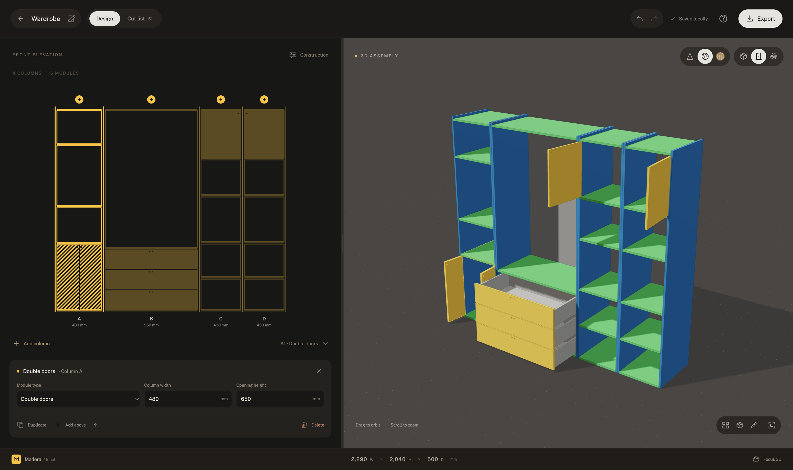

# Madera · Local workshop

[](LICENSE)

An independent furniture builder reconstructed from public videos of [Madera by Xavier (Jack)](https://x.com/KMkota0/status/2049574141171241064). An open-source, browser-local reconstruction of the furniture-design workflow, independently implemented in TypeScript and Three.js. It is not affiliated with the original service.



## Run

Requires Node.js 22.12+ (Node.js 24 recommended).

```sh
npm ci
npm run dev
```

Open **http://localhost:4317** in your browser. For a production build: `npm run build`, then `npm run preview`. No database, credentials, or external API are needed. Fonts are bundled locally.

## Use

- Open Wardrobe, Chest, or Side Table, or create a blank project. Templates also include a bookcase.
- Select a module in the front elevation or 3D preview. Change its type, column width, opening height, or drawer count.
- Add columns and modules, duplicate, delete, reorder upward, undo and redo.
- Switch between colored panels, technical outlines, and oak, walnut, or white materials.
- Open doors and drawers, explode the assembly, orbit the camera, and inspect individual cut-list panels.
- Export editable `.madera.json`, CSV cut lists, a PNG preview, or a GLB model in metres. Print the cut list or use the browser's Save as PDF option.

Projects automatically save in **this browser's local storage**. Browser data clearing removes them. Use Export → Project file for backups or transfer to another browser. Use the same hostname and port on subsequent visits; `localhost` and `127.0.0.1` have separate browser storage.

Keyboard: `⌘Z` undo, `⌘⇧Z` redo, `⌘D` duplicate selected module, `F` fit camera, `Escape` deselect. Control works instead of Command on other platforms.

## Geometry and limits

The app generates square, independent cabinet carcasses with butt joints. Column width includes both side panels; module height is the clear opening. The cut list and meshes share one source in `src/model.ts` and use millimetres. Drawer fronts have a 3 mm reveal; drawer boxes have side allowances. The GLB is converted to metres.

Cut-list sizes are finished panel sizes, excluding saw kerf and machining/joinery allowances. Hardware specifications, engineered load ratings, CNC toolpaths and sheet nesting are outside this build. Check construction details before cutting. Original Madera binary exports and cloud accounts are not supported; this app's `.madera.json` format is intentionally explicit.

Supported design range: 1–8 columns, 1–12 modules per column, up to 8 drawers per module, and a maximum column height of 4 m. Imports are validated before use.

## Verification

```sh
npm test
npm run build
```

Tests cover panel bounds, cut-list/geometry consistency, drawer quantities, project export/import, and invalid imports. The initial release was also checked in Crest on desktop and in a 390-pixel mobile viewport, including real JSON, CSV, PNG and GLB downloads.

## Deploy on Vercel

Import this repository into Vercel. The included `vercel.json` configures Vite, `npm ci`, `npm run build`, and the `dist` output directory. No environment variables or backend services are required. Git integration can deploy updates to the production branch automatically.

Project storage belongs to the browser and site origin. To move a local project to a deployed copy, export its `.madera.json` file and import it on the new site.

## Attribution and license

Application code is licensed under the [MIT License](LICENSE), copyright 2026 Ignacio Pardo.

The furniture-design concept and visual references come from **Madera by Xavier (Jack), @KMkota0**:

- [Original demo](https://x.com/KMkota0/status/2048819029830180989)
- [Launch post](https://x.com/KMkota0/status/2049574141171241064)
- [Walkthrough shared by Fermín](https://x.com/ferminrp/status/2049593890890498236)

This repository contains independently written application code and a screenshot of this implementation. Downloaded third-party videos, screenshots, and investigated repositories are excluded from the source distribution and are not covered by this MIT license.

Three.js retains its MIT license, reproduced in [third-party notices](public/THIRD-PARTY-LICENSES.txt). Public Sans retains its [SIL Open Font License 1.1](public/Public-Sans-LICENSE.txt).
